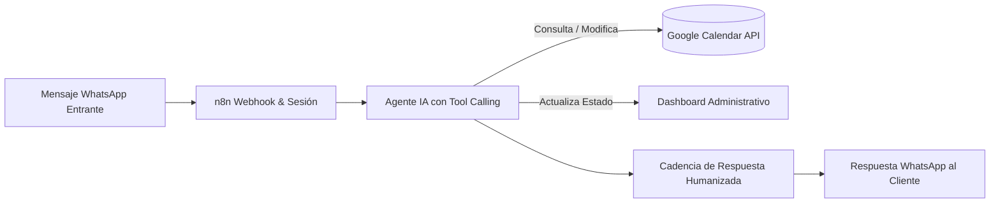

# 🚗 WhatsApp Booking & Turn Management Bot — Atencia Garage (n8n + AI)

> Sistema autónomo de atención por WhatsApp para el lavadero de autos **Atencia Garage**. Permite a los clientes agendar, modificar y cancelar turnos en tiempo real mediante lenguaje natural, sincronizando la disponibilidad con Google Calendar y un panel administrativo, con técnicas de cadencia humana para prevención de bloqueos de número.

---

## 📐 Flujo de Arquitectura

---

## 🎯 Problema de Negocio & Solución

* **Problema:** En el lavadero Atencia Garage, la atención manual por WhatsApp colapsaba los fines de semana: clientes esperando hasta 3 horas para confirmar un turno, superposición de horarios y cancelaciones no registradas que dejaban boxes vacíos.
* **Solución Implementada:**
  1. **Gestión integral de turnos 24/7:** El bot interpreta fechas relativas (*"¿Tienen lugar este viernes a las 3 de la tarde?"* o *"Cambiame el turno para el sábado"*).
  2. **Tool Calling con Google Calendar:** Consulta disponibilidad real y reserva eventos con formato exacto `YYYY-MM-DDTHH:mm:ss-03:00`.
  3. **Sincronización con Dashboard:** Emite eventos en tiempo real para reflejar el estado de ocupación de los boxes en el panel de control del taller.
  4. **Secuencia de tipeo humanizada:** Introduce retrasos dinámicos y estados de escritura (*typing indicator*) para emular el comportamiento de un operador humano y evitar el baneo del número por algoritmos anti-spam de Meta.
  5. **Control de sesión:** Permite finalizar o transferir la conversación a un operador cuando el cliente lo solicita.

---

## 📊 Métricas de Negocio & Impacto (ROI)

* **Disponibilidad:** 100% de consultas atendidas en menos de 5 segundos, 24 horas al día.
* **Tasa de ausentismo:** Reducción del **40%** en turnos perdidos gracias a confirmaciones y reprogramaciones inmediatas.
* **Ahorro operativo:** Más de **25 horas semanales** de atención al cliente automatizadas.

---

## 🚀 Cómo Importar el Workflow

1. Abre tu instancia de n8n.
2. Ve a **Workflows** ➔ **Import from file...**
3. Selecciona [`bot_atencia_garage_workflow.json`](./bot_atencia_garage_workflow.json).
4. Configura tus credenciales de Google Calendar y WhatsApp Cloud API.

---

*Desarrollado por Lorenzo Cona — AI & Automation Specialist / Freelance Developer.*
